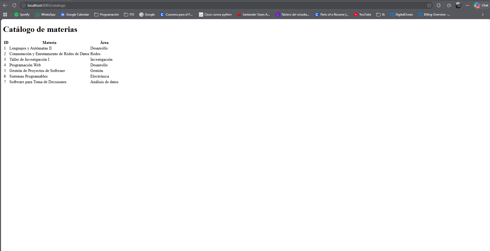
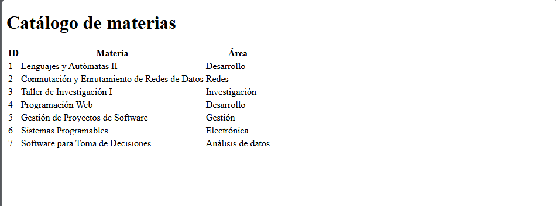
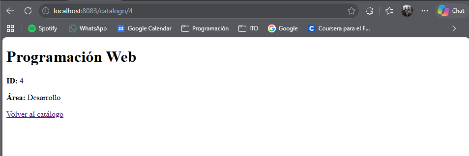
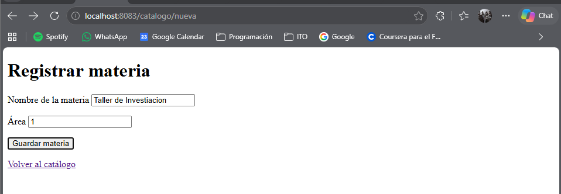
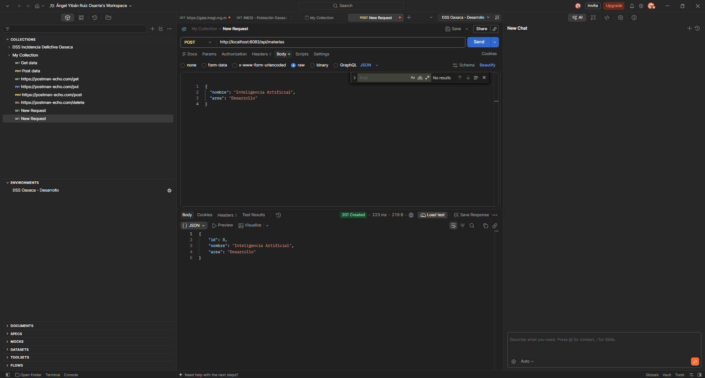

# Actividad 2 · Catálogo de materias con Spring MVC

**Alumno:** Ángel Yibán Ruiz Osante  
**Materia:** Programación Web

El proyecto permite consultar materias, filtrarlas por área, ver su detalle y
registrar nuevas materias desde un formulario HTML o mediante una petición POST
con JSON. La aplicación usa Java 21, Spring Boot y Thymeleaf. El catálogo se
almacena en memoria y vuelve a sus siete materias iniciales al reiniciar.

## Aplicaciones en el VPS

- [Actividad 2 · Catálogo de materias, puerto 8083](http://138.68.234.30:8083/catalogo)
- [Actividad 1 · API original, puerto 8081](http://138.68.234.30:8081/proyecto)

## 1. Listado de materias

`GET /catalogo` obtiene las materias de `CatalogoMaterias`. El controlador
las agrega al `Model` y la plantilla `catalogo.html` genera una fila por
materia con `th:each`. El nombre del autor se lee desde la propiedad
`catalogo.autor` mediante `@Value` y se muestra en la vista.

## 2. Filtro por área con @RequestParam

`GET /catalogo?area=Desarrollo` recibe el área desde la URL y muestra las
materias que coinciden. En el catálogo inicial corresponden a Lenguajes y
Autómatas II y Programación Web.

## 3. Detalle con @PathVariable

`GET /catalogo/4` toma el identificador de la ruta, busca la materia y
muestra su nombre y área. El ID 4 corresponde a Programación Web.

## 4. Registro desde el formulario con @ModelAttribute

`GET /catalogo/nueva` abre el formulario. Al pulsar Guardar materia, el
navegador envía `POST /catalogo`. Spring asigna los campos `nombre` y `area`
a un `MateriaDTO` mediante `@ModelAttribute`. El catálogo asigna el ID,
guarda la materia y el controlador redirige al listado.

## 5. Registro desde Postman con @RequestBody

`POST /api/materias` recibe un cuerpo JSON con `nombre` y `area`.
`@RequestBody` convierte esos datos en un `MateriaDTO`. El endpoint devuelve
la materia con su ID asignado y el estado HTTP `201 Created`.

